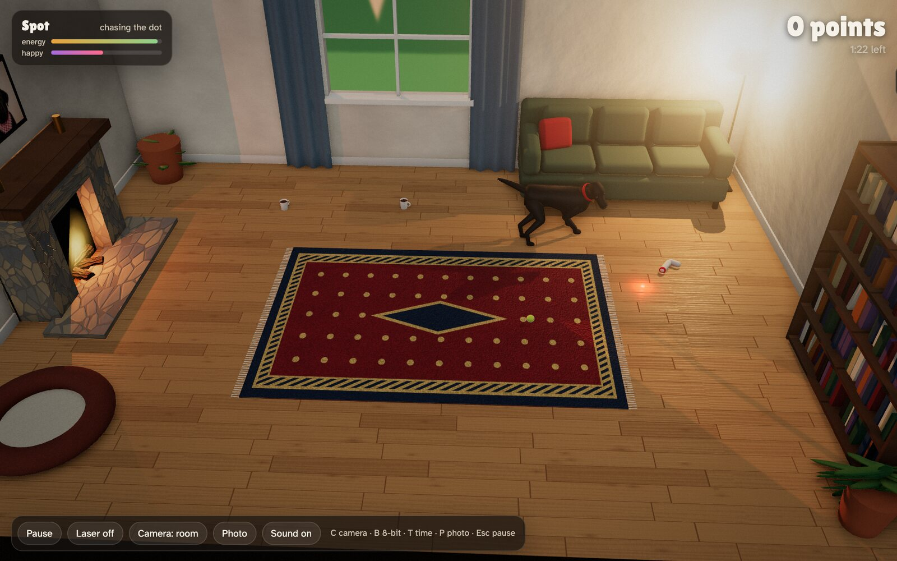
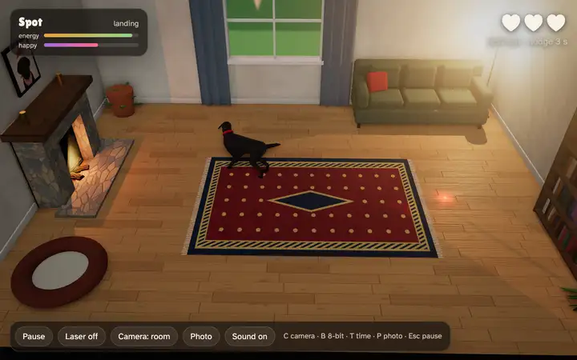
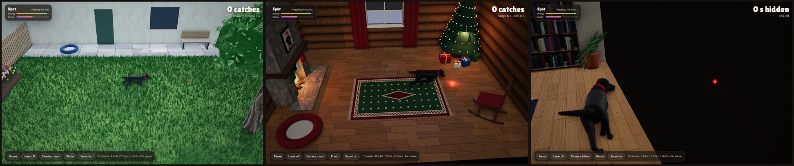
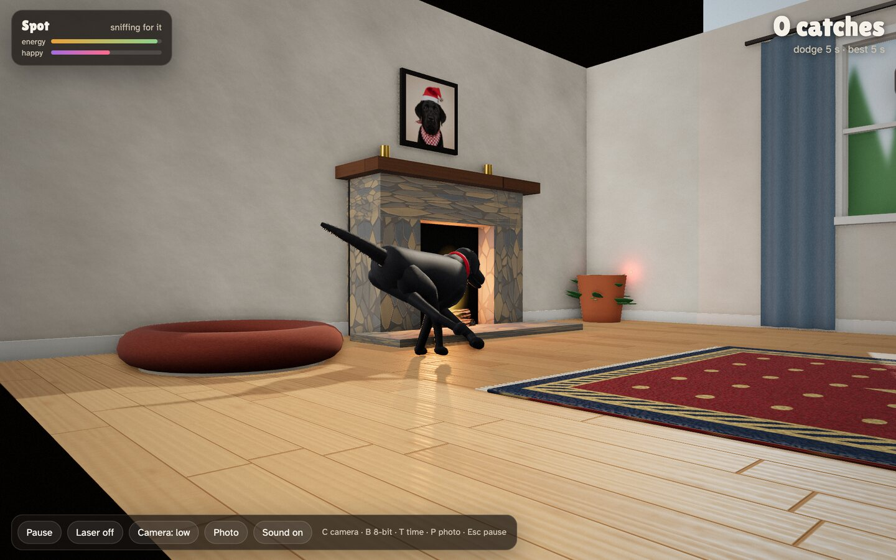
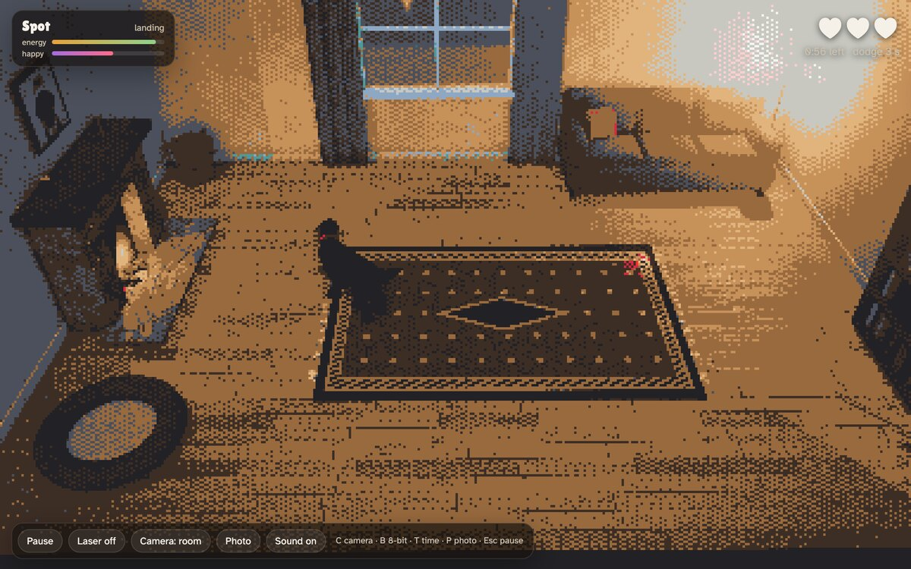

<div align="center">


# Spot-light HD

**A realistic black lab chases your laser dot through a living room, a garden and a snowy cabin.**

[Playing](#playing) · [Modes](#modes) · [Meet Spot](#meet-spot) · [Run it locally](#run-it-locally-step-by-step) · [How it works](#how-it-works) · [Limits](#limits) · [Contributing](#contributing)


[](https://github.com/Gitguy268/spot-light-hd/actions/workflows/test.yml)



</div>

Spot is a two-year-old black lab, and he is sure the red dot is alive. This is the realistic version of [Spot-light](https://github.com/Gitguy268/spot-light): Spot has a furred coat, legs that plant on the floor, and a brain that skids on wood, loses the dot behind the sofa and barks at it on the wall. It still runs from a double-click: the whole game is one `index.html`.

<!-- live-links -->
**Live:** [gitguy268.github.io/spot-light-hd](https://gitguy268.github.io/spot-light-hd/) · [spot-light-hd.vercel.app](https://spot-light-hd.vercel.app)
<!-- /live-links -->

<!-- run-steps:start -->
## Run it locally, step by step

1. **Get the code:**

   ```sh
   git clone https://github.com/Gitguy268/spot-light-hd.git
   cd spot-light-hd
   ```

2. **Open `index.html`** by double-clicking it. There is nothing to install or build.

3. **Optional, for offline install:** double-click `start.command` (macOS; on Linux run `./start.command`). It serves the folder on <http://localhost:5192/> with Python, which lets the browser install the game as an app. Press `Ctrl+C` in the terminal to stop.

**To change the code** you need [Node.js](https://nodejs.org) 22 or newer:

```sh
npm ci
npm run dev       # live-reloading dev server on http://localhost:5191/
npm run build     # rebuilds ./index.html from src/
```
<!-- run-steps:end -->

## Playing



Move the mouse or your finger to steer the dot. Spot runs after it, crouches with a wiggle when he is close, and pounces. Every game ends with a treat for him: a laser game with nothing to catch frustrates a real dog, so the dot always turns into something he can eat.

| Input | What it does |
|---|---|
| Mouse, finger, arrow keys or WASD, gamepad stick | move the laser dot |
| Right-click, `Space`, gamepad A | laser on or off (he goes looking for it) |
| `C`, gamepad Y | camera: room, follow, low (dog's eye), top |
| `P` | photo mode |
| `T` | day, evening, night |
| `B` | 8-bit look |
| `M` | sound on or off |
| `Esc`, gamepad Start | pause |

<p align="center"></p>

## Modes

| Mode | Goal |
|---|---|
| **Dodge** | 60 seconds and 3 lives. Keep the dot out of his paws. |
| **Endless** | No clock. Count his catches and your longest dodge. |
| **Lure** | Steer him into the cup, the sock and the ball to knock them flying. 90 seconds. |
| **Fetch** | Put the dot on a ball, he picks it up, then lead him to his bed. Five balls. |
| **Zoomies** | Lead him through eight glowing rings as fast as you can. |
| **Hide & seek** | Keep the dot where he can't see it, behind the sofa or the tree. 90 seconds. |
| **Relax** | No score. Play until he gets tired, walks to his bed and falls asleep. |

Best scores are kept per place. Stats (metres run, pounces, catches, naps) and 14 achievements are on the title screen.

<details>
<summary><b>Settings</b></summary>

| Setting | Options |
|---|---|
| Quality | Auto (drops a level when the frame rate falls under 40), Low, Medium, High, Ultra |
| Camera | Room, Follow, Low, Top |
| Weather | Clear, Rain, Snow (the garden) |
| Spot's pace | Puppy, Adult, Zoomy |
| Laser colour | Red, Green, Violet |
| Steady hand | how much the dot trembles |
| Volume, 8-bit look, reduce motion, frame rate | |

Everything is saved in the browser's `localStorage`. In a private window it works but forgets on reload.

</details>

## Photo mode

<p align="center"></p>

Press `P` during a game to freeze it, orbit the camera around Spot with the mouse, blur the background with depth of field, pick a look (Natural, Warm, Mono, Film, Cool), adjust the exposure and save a PNG.

<p align="center"></p>

## Meet Spot

Spot is the author's real dog: a black labrador, two years old, with a red collar. These portraits are AI-generated images of him; the first one hangs above the fireplace in the game.

<p align="center">
  
  
  
</p>

## How it works

<details>
<summary><b>Spot's body</b></summary>

Spot is built in code from tubes with elliptical cross-sections (`src/dog.js`), ported from [spot-fetch](https://github.com/Gitguy268/spot-fetch). His coat is shell fur (`src/fur.js`): each body part is drawn 6 to 24 times (by quality), pushed out along its normals, and each layer keeps only the hairs that are that long, with a sheen stretched across the hair direction. Each leg is a two-bone IK chain that stands on a fixed foothold during its stance, so the paws never slide. The gait switches between walk, trot and gallop by speed. On top of that are the pounce (front legs reach, hind legs push), the crouch with a butt wiggle, rearing up at the wall, blinking, panting, breathing and the tail.

</details>

<details>
<summary><b>Spot's brain</b></summary>

`src/brain.js` is plain maths with unit tests (`npm run test:unit`). It is a state machine: chase, crouch, pounce, land, pin (he sniffs where his paws landed, sure the dot is under them), search, rear, bark, sit, rest, sleep and pickup.

- **Grip.** His velocity follows his heading quickly along the body and slowly sideways. How slowly depends on the floor: wood and wet stone are slippery, a rug or grass is not. A sharp turn at speed on wood becomes a skid, with the sound of claws.
- **Sight.** Furniture taller than his eyes blocks his view of the dot; he goes to where he last saw it and sniffs around.
- **Reach.** A dot on the floor can be caught. A dot low on a wall makes him rear up; a high one makes him bark.
- **Energy and mood.** Running tires him (he gets slower and pants harder), resting recovers him, catches make him happier and he wags more.

</details>

<details>
<summary><b>The places, light and sound</b></summary>

- **No image files.** Floorboards, plaster, stone, rugs, upholstery, logs, lawn, patio tiles and bark are painted on canvases at startup (`src/textures.js`), each with a normal map made from a height map, and some with a roughness map.
- **Light.** Sun or moon through the window with soft shadows, a flickering fire, a floor lamp in the evening, fairy lights, image-based light from three.js's RoomEnvironment indoors and a physical sky outdoors, ACES tone mapping, ground-truth ambient occlusion (GTAO) and bloom on High and Ultra.
- **The laser.** A tiny over-bright dot placed on whatever you point at (floor, rug, sofa, wall), a glow, a red spill of light, a hand tremor, and a faint beam in a dark room.
- **Sound.** All synthesised with Web Audio (`src/audio.js`): paws per floor type, panting with a breathing rhythm, barks with formants, the tag jingle, skids, fire crackle, rain and birds.

</details>

<details>
<summary><b>Build, tests and pictures</b></summary>

The source is in `src/`. `npm run build` bundles it with Vite and vite-plugin-singlefile into one HTML file and copies it to `./index.html` with a hash of the sources, so CI can check that the committed build is current (`npm run check-build`).

```sh
npm run test:unit                # brain and storage (node:test)
npx playwright install chromium
npm run smoke                    # 3 places x 7 modes, treat, photo, cameras, 8-bit, from file://
GPU=1 npm run smoke              # same with the real GPU, plus every quality preset
npm run capture                  # regenerates the pictures in docs/
```

CI runs the build check, the unit tests and the smoke test in SwiftShader on every push.

</details>

## Limits

- It needs WebGL 2. On a browser without it, the page says so and links to the classic game.
- Low and Medium quality are for older or phone GPUs; High and Ultra want a recent laptop or desktop GPU. Auto steps down by itself.
- The garden's weather and the cabin's snow are particles, not simulated.
- Spot's body is procedural, not a scanned model, so he is a recognisable black lab rather than a photographic one.

## Classic Spot-light

The original single-file game, with its 2D, 3D and 8-bit views, is in [`classic/`](classic/index.html) and linked from the title screen. Its own repository is [Gitguy268/spot-light](https://github.com/Gitguy268/spot-light).

## Contributing

Issues and pull requests are welcome, see [CONTRIBUTING.md](CONTRIBUTING.md). Change the files in `src/`, run `npm run build` and commit the new `index.html` with your change, and run the tests first.

## Licence

MIT, see [LICENSE](LICENSE). three.js and the fonts keep their own licences, and the portraits of Spot are not covered by the MIT licence. See [NOTICE](NOTICE).
